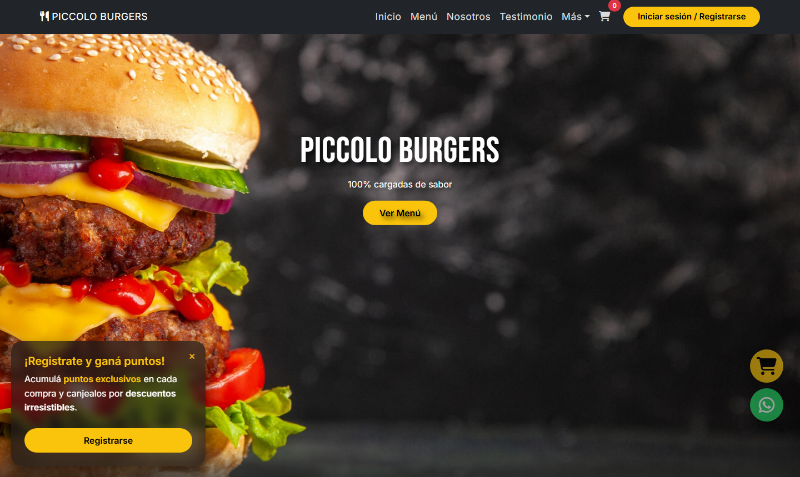
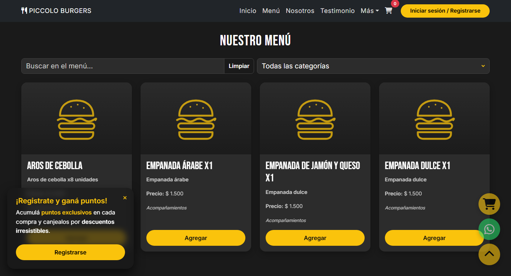
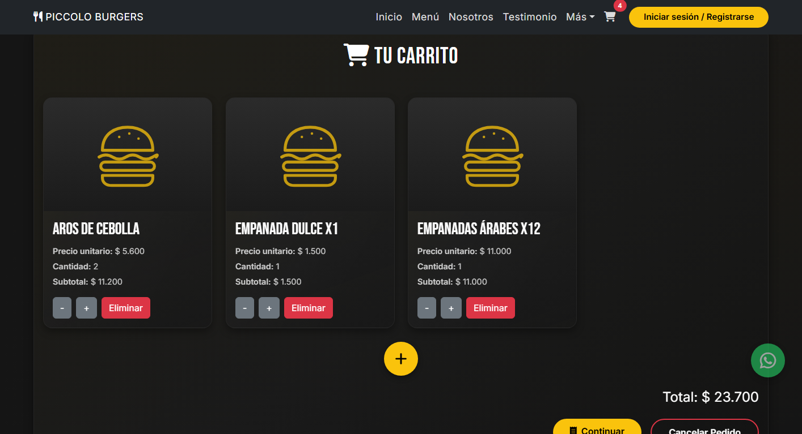
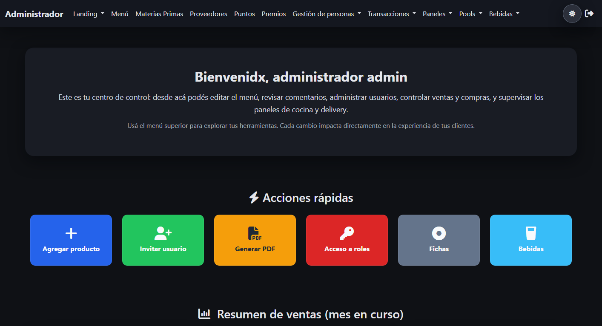
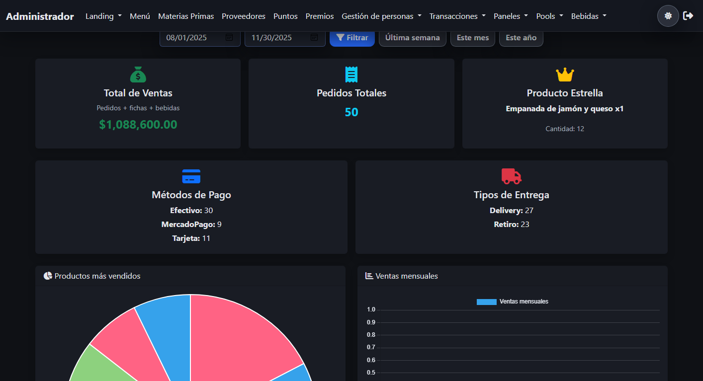

# Piccolo Burgers 🍔

Sistema web para una hamburguesería: un **sitio de pedidos online** con programa de puntos para los clientes y un **panel de administración** para gestionar el día a día del local, desde el menú y el stock hasta la cocina, el delivery y los reportes.


[](https://github.com/yasheyxs/piccoloBurgers/actions/workflows/pruebas.yml)



---

## Funcionalidades

### Para los clientes

- **Menú online** con búsqueda inteligente (por ejemplo, "gaseosa" muestra las bebidas), filtro por categoría y stock disponible en tiempo real.
- **Carrito que reserva el stock** mientras el cliente arma su pedido, así dos personas no compran el último producto al mismo tiempo.
- **Pedido online** con retiro en el local o delivery y elección del medio de pago.
- **Programa de puntos:** cada compra suma puntos, que se canjean como descuento en los pedidos siguientes.
- **Cuenta del cliente:** registro, perfil editable, historial de pedidos con su estado y recuperación de contraseña por email.
- **Formulario de contacto**, testimonios y ubicación del local.

| Menú con búsqueda y filtros | Carrito con stock reservado |
|---|---|
|  |  |

### Para el local (panel de administración)

- **Pedidos en tiempo real:** panel de cocina con los pedidos en preparación y panel de delivery con los envíos y su ubicación en el mapa.
- **Menú y stock:** productos con foto y precio, materias primas, insumos que usa cada producto, proveedores y compras. La disponibilidad del menú se calcula según los insumos en stock.
- **Clientes y fidelización:** ficha de cada cliente, canje de puntos por descuentos o premios, y configuración del valor de los puntos.
- **Pool y bebidas:** turnos de las mesas de pool, venta de fichas y jarras por jornada, con cierre de caja y estadísticas.
- **Reportes:** ventas y estadísticas con gráficos, exportables a PDF y Excel.
- **Contenido del sitio:** banners, testimonios y mensajes de contacto.
- **Usuarios con roles** (administración, empleado y delivery): cada uno ve solo lo que necesita para su trabajo.

| Inicio del panel | Reporte de ventas |
|---|---|
|  |  |

---

## Arquitectura

El sistema está dividido en dos partes independientes, que se pueden publicar por separado:

```
Navegador ──▶ frontend (Nginx) ──▶ sitio de clientes (HTML, CSS y JavaScript)
                     │
                     └── /api, /admin, /img ──▶ backend (PHP + Apache) ──▶ MySQL
```

- **Frontend** (`frontend/`): el sitio de clientes es una aplicación estática que obtiene todos los datos de la API. No necesita PHP ni acceso a la base de datos.
- **Backend** (`backend/`): una **API REST en JSON** (`/api/v1`) con el menú, el carrito, los pedidos y las cuentas de clientes, más el panel de administración. Solo la carpeta `public/` es accesible desde el navegador.
- **Docker Compose** levanta todo con un comando: el frontend en Nginx, que también reenvía la API y el panel al backend, y el backend en Apache con MySQL.

La API está documentada con ejemplos en [`docs/API.md`](docs/API.md).

## Tecnologías

| Parte | Tecnologías |
|---|---|
| Frontend | HTML5, CSS3, JavaScript con módulos nativos, Bootstrap 5, Nginx |
| Backend | PHP 8.2+, API REST propia, Apache, Composer |
| Base de datos | MySQL 8 |
| Librerías | Dompdf (PDF), PhpSpreadsheet (Excel), PHPMailer (emails), Chart.js y DataTables (panel) |
| Infraestructura | Docker y Docker Compose |

## Seguridad

- **Permisos por rol en el servidor:** cada pantalla del panel verifica el rol desde una única tabla de permisos; lo que no está permitido explícitamente solo lo ve un administrador.
- **Protección CSRF** en todos los formularios y acciones del panel, y en la API (solo acepta JSON).
- **Contraseñas con bcrypt**, límite de intentos de inicio de sesión y cierre de sesión por inactividad.
- **Precios calculados en el servidor:** el total de un pedido nunca depende de lo que envía el navegador.
- **Cabeceras de seguridad** (Content-Security-Policy, X-Frame-Options, etc.) y configuración sensible fuera del código, en variables de entorno.

---

## Probarlo

### Con Docker (recomendado)

```bash
git clone https://github.com/yasheyxs/piccoloBurgers.git
cd piccoloBurgers
cp backend/.env.example backend/.env    # completar usuario y contraseña de MySQL
docker compose up -d --build
```

| | Dirección |
|---|---|
| Sitio | http://localhost:8080 |
| Panel de administración | http://localhost:8080/admin/ |
| phpMyAdmin | http://localhost:8081 |

La base de datos se crea sola con datos de ejemplo la primera vez.

### Con XAMPP

1. Copiar el proyecto en `C:\xampp\htdocs\piccoloBurgers` (o `/opt/lampp/htdocs/piccoloBurgers`).
2. Crear una base vacía llamada `piccolodb`.
3. Instalar las dependencias: `cd backend && composer install`.
4. Copiar `backend/.env.example` como `backend/.env.local` y completar los datos de MySQL (con XAMPP, `MYSQL_HOST=127.0.0.1`).
5. Crear las tablas y cargar los datos de ejemplo: `php bin/migrar.php --con-datos` (desde `backend/`).
6. Entrar a http://localhost/piccoloBurgers/ (sitio) y http://localhost/piccoloBurgers/backend/public/admin/ (panel).

Requisitos: PHP 8.2 o superior con las extensiones `pdo_mysql`, `mbstring`, `gd` y `zip`, Composer, MySQL 8 y Apache con `mod_rewrite`.

### Usuarios de prueba

| Dónde | Usuario | Contraseña | Rol |
|---|---|---|---|
| Sitio | Teléfono `0000825022` (código +54) | `Cliente1!` | Cliente con puntos acumulados |
| Panel | `Usuario` | `Usuario1!` | Administración: acceso completo |
| Panel | `Empleado` | `Empleado1!` | Empleado: cocina, pool y bebidas |
| Panel | `Delivery` | `Delivery1!` | Delivery: solo el panel de envíos |

### Pruebas automáticas

```bash
php backend/tests/ApiTest.php http://localhost:8080/api/v1
PANEL_USUARIOS="admin:Usuario:Usuario1!,empleado:Empleado:Empleado1!,delivery:Delivery:Delivery1!" php backend/tests/PanelPermisosTest.php http://localhost:8080/admin
php backend/tests/ValidarTelefonoTest.php
```

- `ApiTest` recorre la API como un cliente: menú, carrito, registro, pedido, historial y sesión.
- `PanelPermisosTest` entra al panel con cada rol y verifica a qué secciones puede acceder.

Las tres pruebas corren solas en GitHub Actions con cada cambio, levantando el sistema completo con Docker.

---

## Estructura del repositorio

```
piccoloBurgers/
├── frontend/              sitio de clientes
│   ├── public/            páginas, estilos, scripts e imágenes
│   └── Dockerfile         imagen de Nginx
├── backend/
│   ├── public/            lo único expuesto: api/v1, admin/ e img/
│   ├── src/               API, panel y reglas de negocio
│   ├── views/admin/       plantillas del panel
│   ├── config/            configuración y permisos del panel
│   ├── database/          migraciones y datos de ejemplo
│   ├── bin/migrar.php     aplica los cambios pendientes de la base
│   ├── tests/             pruebas automáticas
│   └── Dockerfile         imagen de PHP + Apache
├── docs/API.md            documentación de la API
└── docker-compose.yml     entorno completo
```

Cada parte tiene su propio README con más detalles: [`frontend/`](frontend/README.md) y [`backend/`](backend/README.md).
